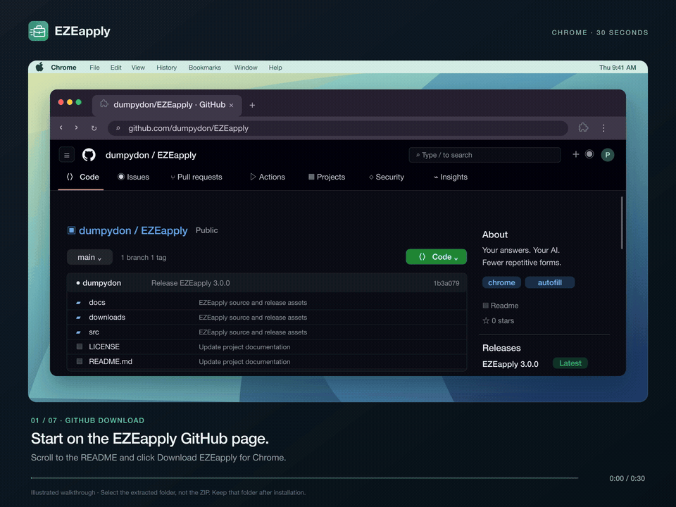

<p align="center"></p>
<p align="center">Your answers. Your AI. Fewer repetitive forms.</p>
<p align="center">Created by <a href="https://github.com/dumpydon">Piyush Agarwal</a></p>

<p align="center"><a href="https://github.com/dumpydon/EZEapply/releases/latest/download/EZEapply.zip"><strong>↓ Download EZEapply for Chrome</strong></a> · <a href="docs/media/install-ezeapply.mp4">Watch the 15-second install film</a></p>

## Install

1. [Download EZEapply.zip](https://github.com/dumpydon/EZEapply/releases/latest/download/EZEapply.zip) and **extract it**.
2. Move the extracted **EZEapply** folder somewhere permanent. Keep it there while the extension is installed.
3. Open **`chrome://extensions`** in Chrome and turn on **Developer mode**.
4. Click **Load unpacked**, then select the **EZEapply** folder containing `manifest.json`.
5. Pin EZEapply from Chrome’s extensions menu. Open it, add your profile and reusable answers, and you’re ready.

[](docs/media/install-ezeapply.mp4)

_Original illustrated macOS/Chrome walkthrough · [Full-resolution MP4](docs/media/install-ezeapply.mp4) · [Written steps & troubleshooting](docs/INSTALL.md). Chrome 120 or newer. Windows and Linux use the same Chrome steps._

## What it does

- **One-click answers:** a compact sidebar with custom fields, search, editing, drag-to-reorder and instant copying.
- **Smart autofill:** matches question meaning through keywords, synonyms and units; handles supported text fields, dropdowns, radios, frames and open web components. Optional automatic filling catches new form steps.
- **Your AI:** connect OpenAI, Anthropic, Gemini or another supported provider using your own key. Choose models and draft answers from your profile, résumé and background, then review them.
- **Application analytics:** confirmed LinkedIn Easy Apply and external submissions, daily goals, manual corrections, and 7-, 15- and 30-day charts. LinkedIn is blue; external forms are teal.
- **Small conveniences:** résumé attachment, undo for supported changes, editable profile shortcuts, optional closed-panel floating button, and a LinkedIn company-follow opt-out.

## A few useful details

Profiles, reusable answers and application history stay in your browser. AI requests go directly to the provider you choose when you press **Generate**; its usage charges apply. API keys stay in separate local storage and are excluded from profile and analytics exports. There is no EZEapply account or subscription.

EZEapply keeps existing answers and never submits applications for you. Bespoke widgets and some embedded forms still need manual input. Review filled values before submitting; analytics counts confirmed submissions, so ambiguous confirmations may need a manual correction. [Privacy & permissions](docs/PRIVACY.md) · [AI setup](docs/AI.md).

**Updating:** export your profile and reusable answers first, replace the files in the same installed folder with the new ZIP’s contents, then click **Reload** at `chrome://extensions`. Refresh open application pages. Keep the folder and extension installed to preserve local data.

## For developers

```sh
npm ci
npm run verify
npm run package
```

Load `dist/extension` for development. `npm run package` creates `downloads/EZEapply.zip` and its checksums. Everything builds from this repository; no other extension, account or source cache is required. [Architecture & checks](docs/DEVELOPMENT.md) · [Review notes](docs/CODE-REVIEW.md) · [Film source](media-src/README.md).

Copyright © 2026 Piyush Agarwal. [Terms for the original code](LICENSE) · [Third-party notices](THIRD-PARTY-NOTICES.md).
